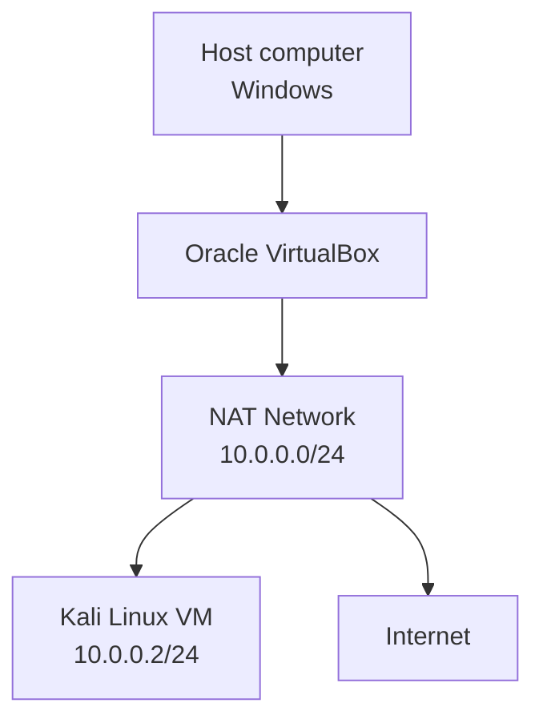

# Lab architecture

## Overview

The host operating system runs Oracle VirtualBox. Kali Linux runs as a guest virtual machine and connects to a VirtualBox NAT Network with the IPv4 prefix `10.0.0.0/24`.

The NAT Network provides outbound internet access to the guest. The Kali guest uses the static address required by the Week 1 task: `10.0.0.2/24`.

## Network layout

## Addressing

| Item | Value |
|---|---|
| Network address | `10.0.0.0/24` |
| Kali guest address | `10.0.0.2/24` |
| Typical NAT gateway used in this lab | `10.0.0.1` |

The module notes that `10.0.0.1` can be used as the gateway when internet connectivity needs troubleshooting. Confirm the actual gateway shown by `ip route` in the guest.

## Virtual machine integration

The Kali VM is configured with:

- Shared Clipboard: **Bidirectional**
- Drag and Drop: **Bidirectional**
- Shared folder name: **downloads**
- Host folder: the host machine's Downloads directory
- Auto-mount: enabled
- Typical Kali mount path: `/media/sf_downloads`

## Address conflict check

Do not assign `10.0.0.2` to another guest on the same NAT Network. If DHCP is enabled on the NAT Network, make sure its lease allocation does not result in another VM receiving the Kali guest's static address.
