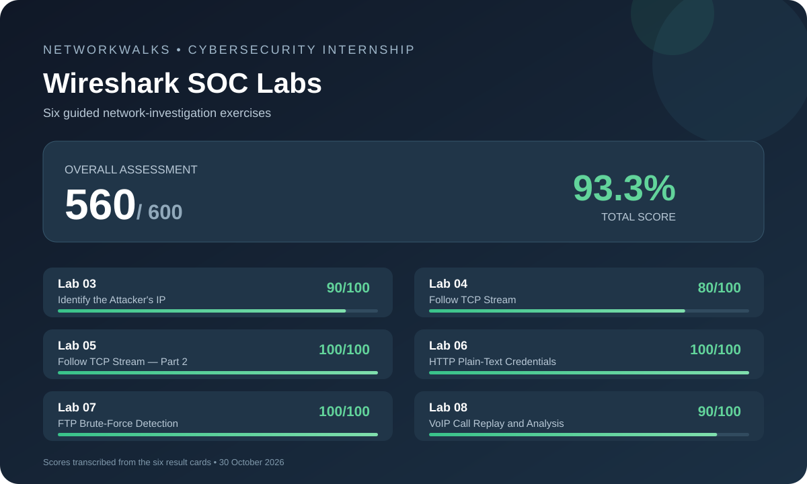

# Wireshark SOC Labs — Cybersecurity Internship Portfolio

A record of six guided Wireshark investigations completed as part of my NetworkWalks cybersecurity internship work. The exercises focused on reading packet captures, reconstructing network conversations and recognising security weaknesses that matter to a Security Operations Centre (SOC).

## Results

| Lab | Investigation | Score |
|---|---|---:|
| 03 | Identify the Attacker's IP | 90/100 |
| 04 | Follow TCP Stream | 80/100 |
| 05 | Follow TCP Stream — Part 2 | 100/100 |
| 06 | HTTP Plain-Text Credential Exposure | 100/100 |
| 07 | FTP Brute-Force Detection | 100/100 |
| 08 | VoIP Call Replay and Analysis | 90/100 |
| **Overall** | **6 practical labs** | **560/600 (93.3%)** |

The scores above are transcribed from the six result cards dated 30 October 2026.

## Lab documentation

Each lab has a separate write-up describing its objective, the investigation workflow, relevant Wireshark features or display filters, the security lesson, and the assessment score.

| Lab | What I practised | Write-up |
|---|---|---|
| 03 | SYN traffic review and TCP port-scan interpretation | [Identify the Attacker's IP](labs/lab-03-attacker-ip/README.md) |
| 04 | TCP conversations and Follow TCP Stream | [Follow TCP Stream](labs/lab-04-follow-tcp-stream/README.md) |
| 05 | HTTP streams, page content and hidden HTML comments | [Follow TCP Stream — Part 2](labs/lab-05-follow-tcp-stream-part-2/README.md) |
| 06 | HTTP POST requests and plaintext form-data exposure | [HTTP Plain-Text Credentials](labs/lab-06-http-plain-text-credentials/README.md) |
| 07 | FTP authentication traffic and brute-force indicators | [Brute-Force Detection](labs/lab-07-brute-force-detection/README.md) |
| 08 | SIP signalling, RTP media and VoIP stream analysis | [VoIP Call Replay](labs/lab-08-voip-call-replay/README.md) |

## Skills practised

- **Packet analysis:** packet capture review, display filters, protocol identification and packet-field inspection.
- **TCP investigation:** conversation review, SYN direction, stream reconstruction and client/server data-flow interpretation.
- **Application-protocol analysis:** HTTP requests and responses, form submission details, FTP authentication exchanges, SIP call signalling and RTP media.
- **SOC investigation habits:** following an observable trail, correlating request and response packets, counting repeated events, identifying suspicious patterns and recording evidence.
- **Security awareness:** plaintext data exposure, weakly protected services, brute-force behaviour and the need for encrypted transport.

## Investigation workflow

1. Start or inspect the capture provided by the lab.
2. Narrow the packet list with a protocol or field-based display filter.
3. Inspect packet details, conversations and request/response direction.
4. Reconstruct a conversation with **Follow TCP Stream** or inspect the relevant protocol stream.
5. Correlate the observations and identify the security implication.
6. Record the conclusion and the result shown by the lab.

## Scope and responsible sharing

These are **guided training-lab exercises**, not production incident-response cases. The write-ups describe the work at a learning-outcome level and avoid publishing scenario credentials, passwords, sensitive identifiers, payment details, voice content, packet captures or answer keys.

The original NetworkWalks lab guides and answer-key PDFs are not redistributed in this repository. They are training-provider material; share them only where the provider's permission and terms explicitly allow it. Lab 03's procedure guide was not included in the materials supplied for this write-up, so its notes are deliberately limited to the tasks visible on its result card.

No real organisation's network was tested as part of these write-ups. Any future packet captures or screenshots added here should be checked for personal data and secrets before publication.

## Repository contents

- \`assets/results-summary.svg\` — original vector summary of the six assessment results.
- \`labs/\` — individual lab notes and learning outcomes.

## Tools and protocols

**Tool:** Wireshark  
**Protocols encountered:** TCP, HTTP, FTP, SIP and RTP  
**Related concepts:** SYN scanning, TCP stream reconstruction, plaintext credential exposure, brute-force detection, VoIP analysis, HTTPS, TLS and SRTP.

---

This portfolio is a learning record. It does not claim professional SOC employment or independent testing of live production systems.
